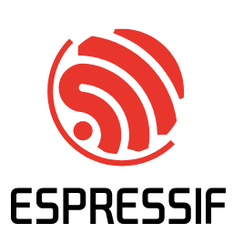
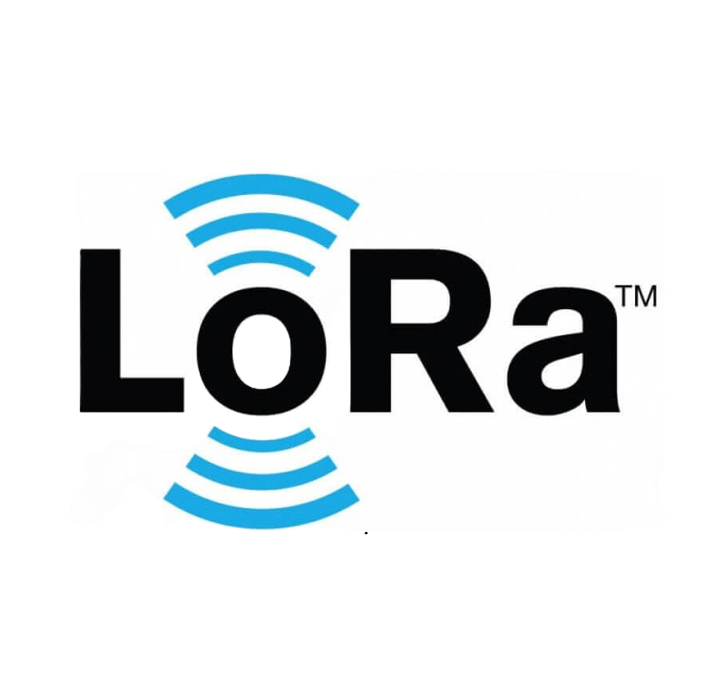
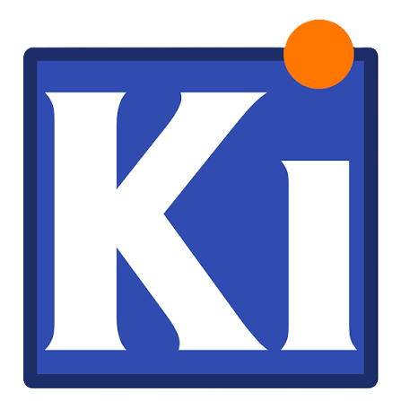
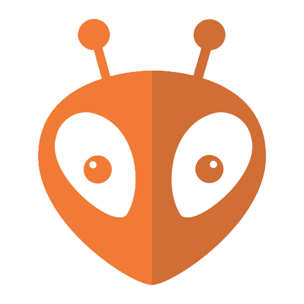
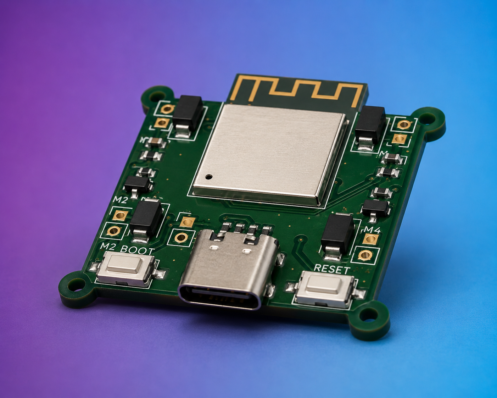
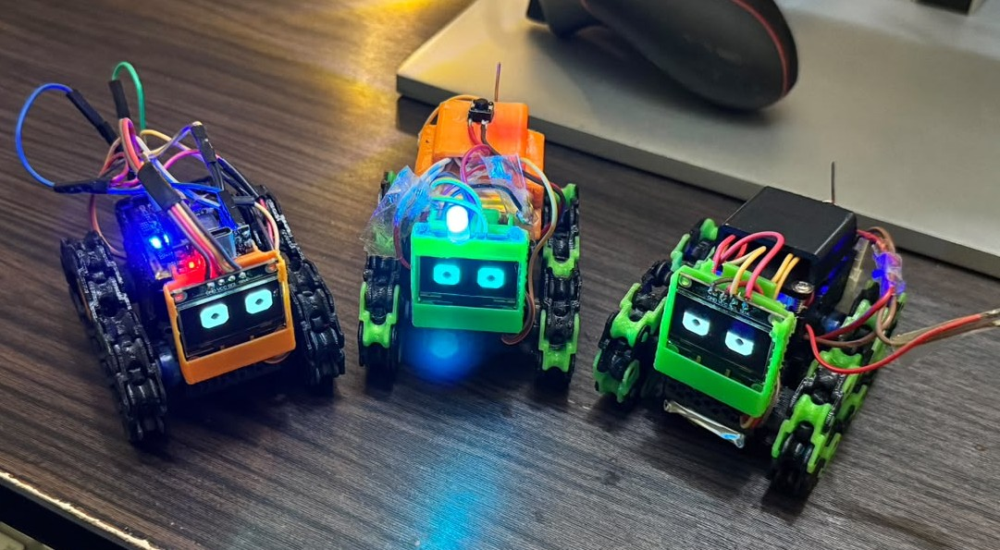
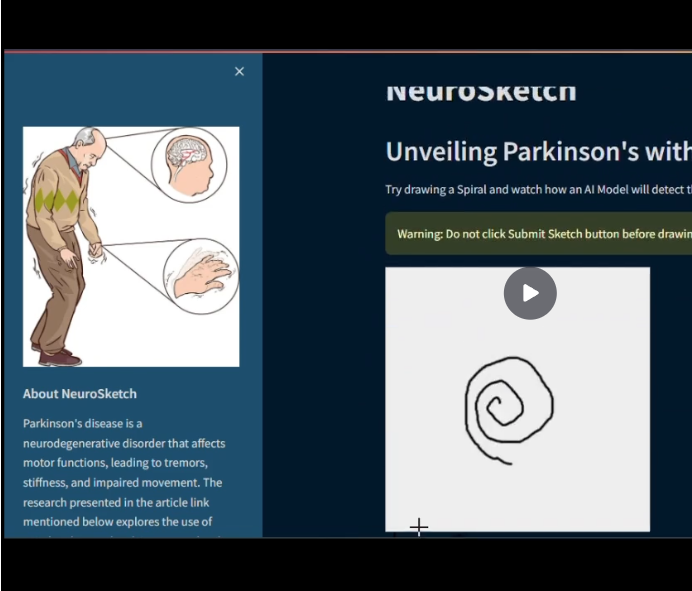
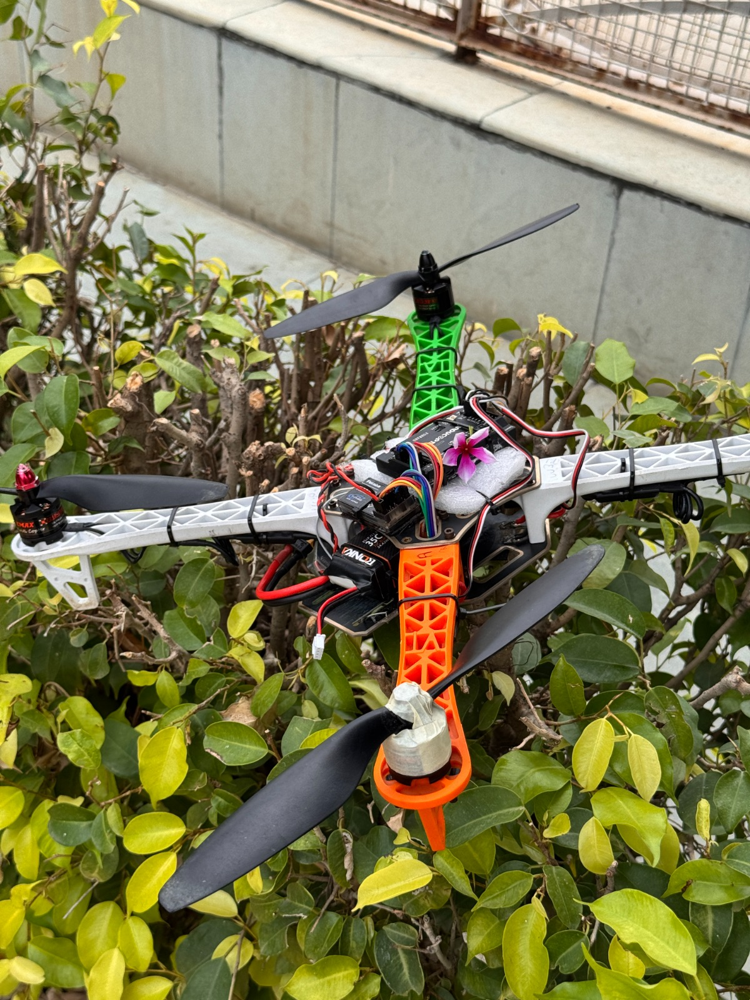
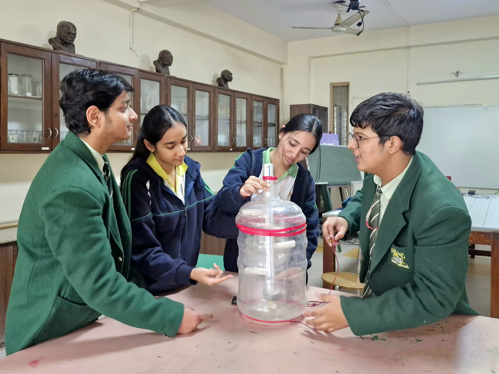

<div align="center">

# 👋 Hi, I'm Senthil Arasu

<p align="center">
  
</p>

### Solving for a Cause • Robotics • Embedded Systems • PCB Design • IoT • AI

*Turning ideas into real-world solutions through engineering.*


<p>
<a href="https://www.linkedin.com/in/prajeshnair"></a>
<a href="https://github.com/Prajesh-Nair"></a>
<a href="mailto:nairprajesh2007.github@gmail.com"></a>
</p>


</div>

---

# 👨🏻‍💻 About Me

<table>
<tr>

<td width="35%" align="center">


<br><br>

### Student Innovator

Building technology that solves real-world problems.

</td>

<td width="65%">

```yaml
Name:
  Prajesh Nair

Education:
  Final Year High School Student

Current Roles:
  • Co-Founder - Knight Labs
  • Vice President — The QU4D COACH
  • Techinical Director - Entwinity

Interests:
  • Robotics
  • Embedded Systems
  • IoT
  • PCB Design
  • Artificial Intelligence
  • Aerospace
  • Automobiles
  • Entrepreneurship

Currently Building:
  • JATAYU Flight Controller
  • DialPad!
  • A Pcb Fabricator

Learning:
  • CAD
  • Advanced PCB Design
  • Drone Flight Control
```

</td>

</tr>
</table>

---

# What I Do

I enjoy building products from the ground up—from designing circuits and PCBs to writing firmware, developing software, and creating intuitive user interfaces.

My interests primarily revolve around:

- Robotics
- Drone Technology
- Internet of Things
- Embedded Systems
- Artificial Intelligence
- Software Development
- PCB Design
- Engineering for Social Impact

---

# ⚙️ Tech Stack

## Programming Languages

<p>


</p>

---

## Embedded Systems

<p>





</p>

---

## Software & Tools

<p>







</p>

---

# 🛠️ Featured Projects

---

<table>

<tr>

<td width="40%" align="center">

## 🎮 GameBox

**RFID-Powered Desktop Automation Hub**

</td>

<td width="60%">

GameBox is a modern Windows desktop application that turns physical RFID cards into programmable automation triggers. Scan a card to launch apps, games, websites, commands, or custom multi-step workflows.

### Highlights

- Arduino Nano + RC522 RFID reader
- Automatic serial-port detection and reconnection
- RFID cards, workflows, actions, and activity logs stored in SQLite
- Launch apps, Start Menu programs, files, folders, websites, and shell commands
- Control Windows volume, Arduino RGB LEDs, delays, and desktop notifications
- Responsive PySide6 interface with dashboard, cards, workflows, settings, and activity views

**Tech:** Python, PySide6, SQLite, PySerial, PyCAW / COMTypes, Arduino C++

</td>

</tr>

</table>

---

<table>

<tr>

<td width="40%">



</td>

<td width="60%">

# JATAYU Flight Controller

An affordable brushed flight controller currently under development at **The QU4D COACH**.

### Highlights

- ESP32-S3
- MPU6050 IMU
- VL53L0X ToF Sensor
- SI2300 MOSFET Motor Drivers
- Custom Designed PCB
- Designed in KiCad

**Status**

Active Development

</td>

</tr>

</table>

---

<table>

<tr>

<td width="40%">



</td>

<td>

# Blocky

Designed and built a WiFi-controlled robot car with an expressive OLED face and a full browser-based control dashboard — no app required.

### Specifications

- ESP32-C3 Super Mini (WiFi)
- 2x SG90 Servos (Modified Continuous Rotation)
- 0.96" 128x64 OLED Display
- Li-Po Battery + TP4056 Charging
- Web Dashboard (Joystick Control, Faces, Clock, Weather, Mini-Games)
- 3D-Printed Chassis ([whybit.in](https://whybit.in/#/))

</td>

</tr>

</table>

---

<table>

<tr>

<td width="40%">


</td>

<td>

# Leak Alert Sentinel

A smart household safety device capable of detecting hazardous LPG and Carbon Monoxide leaks.

### Features

- ESP32
- Wi-Fi Dashboard
- Bluetooth Mobile App
- MQ2 & MQ7 Sensors
- Temperature & Humidity Monitoring
- Real-Time Alerts

</td>

</tr>

</table>

---

<table>

<tr>

<td width="40%">



</td>

<td>

# NeuroSketch

AI-powered neurological screening platform designed for early detection using simple online tests.

### Modules

- Parkinson's Screening
- Spiral Analysis
- Voice Analysis
- Finger Tapping
- Hand Tracking
- Reaction Test
- Memory Test

**Goal**

Making neurological health screening more accessible.

</td>

</tr>

</table>

---

<table>

<tr>

<td width="40%">



</td>

<td>

# Custom Quadcopter

Designed and assembled a custom-built quadcopter.

### Specifications

- EMAX 920KV Motors
- 30A ESC
- APM 2.8 Flight Controller
- 10-inch Propellers
- GoPro Payload
- FlySky i6

</td>

</tr>

</table>

---

<table>

<tr>

<td width="40%">



</td>

<td>

# ReSoil

Research & Development project focused on sustainable biofertilizer compost generation.

Status:

Ongoing Research

</td>

</tr>

</table>


---

# 🏆 Experience & Leadership

### President — THE QU4D COACH **(Oct 2025 - Present)**

President of The QU4D COACH, a community dedicated to helping people learn and build their own drones. Leading technical development, mentoring, and making drone technology accessible through hands-on learning.

**Location:** India

---

### Student Mentor @ STEAM Camp 2025 — DLF Public School **(May 2025)**

Mentored students through hands-on STEM activities including robotics, drones, coding, aerodynamics, and astronomy. Fostered creativity, teamwork, and problem-solving through experiential learning.

---

### DLF Public School **(2 years 1 month)**

#### **Science Captain** (2023-2024)
Led students in hands-on scientific exploration through experiments, research, and collaborative learning. Encouraged curiosity, innovation, and practical application of scientific concepts.

#### **Cyber Captain** (2024-2025)
Led initiatives to promote digital safety and responsible technology use within the school community. Mentored peers, organized awareness activities, and supported cybersecurity best practices.

---

# 📸 Gallery

<table>

<tr>

<td></td>
<td></td>
<td></td>

</tr>

<tr>

<td></td>
<td></td>
<td></td>

</tr>

</table>

---

# Currently Exploring

- Flight Controller Development
- PCB Design
- Embedded AI
- ESP32 Development
- Autonomous Robotics
- RTOS
- Computer Vision
- Sensor Fusion
- Drone Navigation

---

# Future Goals

- Build an open-source flight controller.
- Develop affordable engineering solutions for education.
- Contribute to robotics and embedded systems research.
- Pursue engineering focused on robotics, embedded systems, and aerospace technologies.
- Continue mentoring and growing engineering communities.

---

# 🤝 Let's Connect

I'm always open to collaborating on exciting engineering projects, robotics, embedded systems, PCB design, drones, and AI.

<p>

<a href="https://www.linkedin.com/in/prajeshnair">LinkedIn</a> •
<a href="https://github.com/Prajesh-Nair">GitHub</a> •
<a href="mailto:nairprajesh2007.github@gmail.com">Email</a>

</p>

---

<div align="center">

### *"Create • Build • Innovate"*

If you like my work, consider following my journey.

</div>
