<div align="center">

# 👋 Hi, I'm Senthil Arasu
<p align="center">
  
</p>

### Solving for a Cause • Robotics • Embedded Systems • PCB Design • IoT • AI

*Turning ideas into real-world solutions through engineering.*

<!--
<p>
<<a href="https://www.linkedin.com/in/prajeshnair"></a>
<a href="https://github.com/Prajesh-Nair"></a>
<a href="mailto:nairprajesh2007.github@gmail.com"></a>
</p>-->


</div>

---

# 👨🏻‍💻 About Me

<table>
<tr>

<td width="35%" align="center">


<br><br>

### Building things that make a difference

Building technology that solves real-world problems.

</td>

<td width="65%">

```yaml
Name:
  Senthil Arasu J

Education:
  Final Year High School Student @ Vels Vidyashram

Current Roles:
  • Co-Founder - Knight Labs
  • Vice President — The QU4D COACH
  • Techinical Director - Entwinity

Interests:
  • Robotics
  • Embedded Systems
  • IoT
  • PCB Design
  • Artificial Intelligence
  • Aerospace
  • Automobiles
  • Entrepreneurship

Currently Building:
  • JATAYU Flight Controller
  • DialPad!
  • A Pcb Fabricator

Learning:
  • CAD
  • Advanced PCB Design
  • Drone Flight Control
```

</td>

</tr>
</table>

---

# What I Do

I enjoy building products from the ground up—from designing circuits and PCBs to writing firmware, developing software, and creating intuitive user interfaces.

My interests primarily revolve around:


---

# ⚙️ Tech Stack

## Programming Languages

<p>


</p>

---

## Embedded Systems

<p>


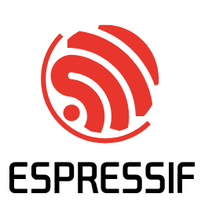
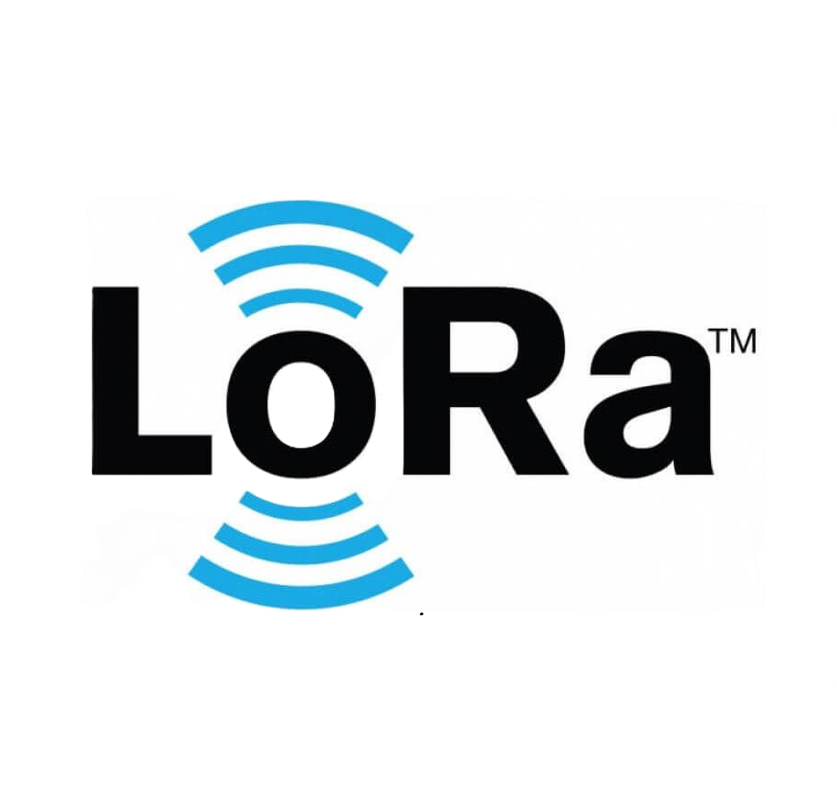

</p>

---

## Software & Tools

<p>


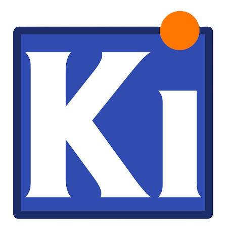


</p>

---

# 🛠️ Featured Projects

---

<table>

<tr>

<td width="40%" align="center">

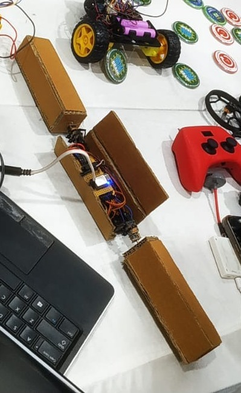

</td>

<td width="60%">

# UniBot
UniBots are small wireless robots that work together to accomplish a task collectively. A simple swarm robot!

### Highlights

- ESP12-E - Custom perfboard circuit
- Hardware: AD002 + N20 Motors
- Software: Micropython + Python(PynPut and Sockets)
- two-axis articulated drive mechanism
- Wi-Fi Communication
- 

**Tech:** Python, PySide6, SQLite, PySerial, PyCAW / COMTypes, Arduino C++

</td>

</tr>

</table>

---

<table>

<tr>

<td width="40%">

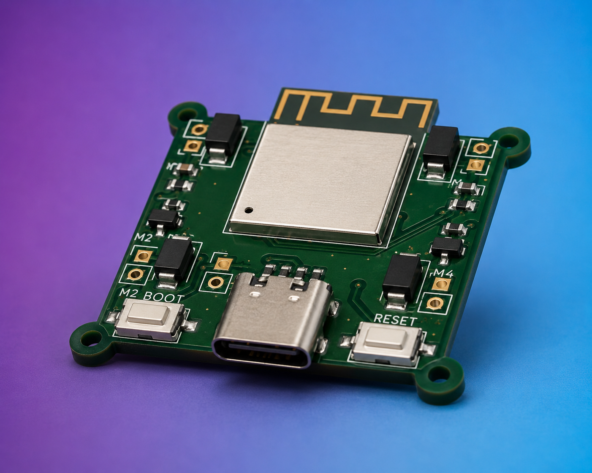

</td>

<td width="60%">

# JATAYU Flight Controller

An affordable brushed flight controller currently under development at **The QU4D COACH**.

### Highlights

- ESP32-S3
- MPU6050 IMU
- VL53L0X ToF Sensor
- SI2300 MOSFET Motor Drivers
- Custom Designed PCB
- Designed in KiCad

**Status**

Active Development

</td>

</tr>

</table>

---

<table>

<tr>

<td width="40%">

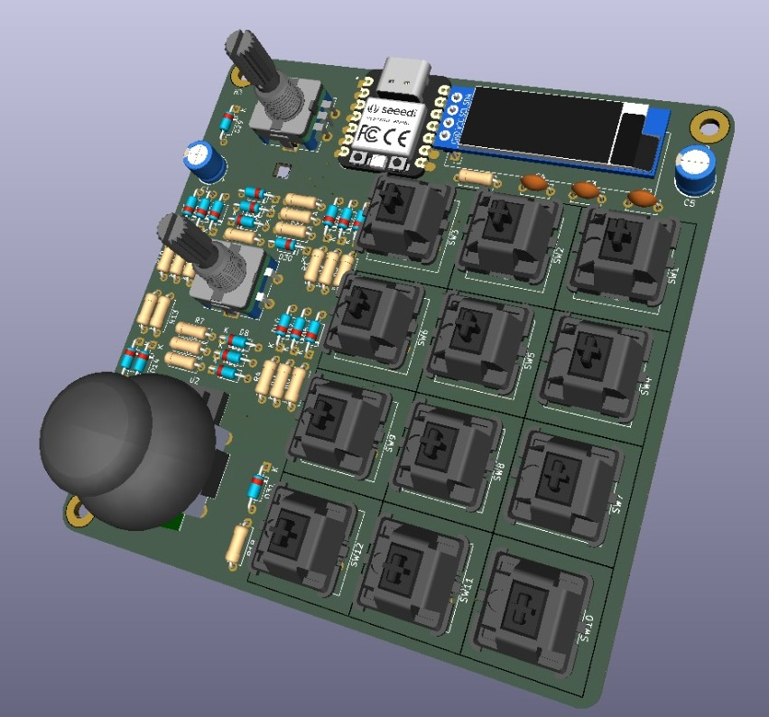
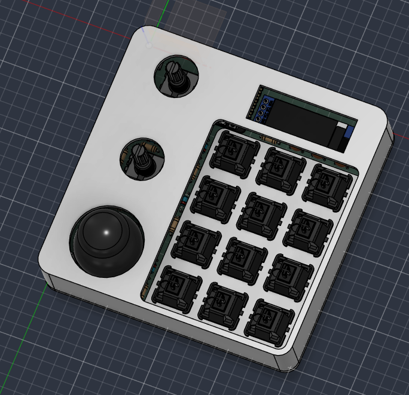
</td>

<td>

# DialPad!

A custom-designed macropad built around the Seeed Studio XIAO RP2040. Built to control 3D desgin softwares and Video Games!

### Specifications

- XIAO RP2040-based hardware architecture
- 12-key programmable macro controller
- Integrated display, dual rotary encoders and joystick.
- Li-Po Battery + TP4056 Charging
- Resistor ladder wiring method - Ran out GPIOs!
- Custom PCB designed in KiCad
- Custom enclosure designed in Fusion 360

</td>

</tr>

</table>

---

<table>

<tr>

<td width="40%">

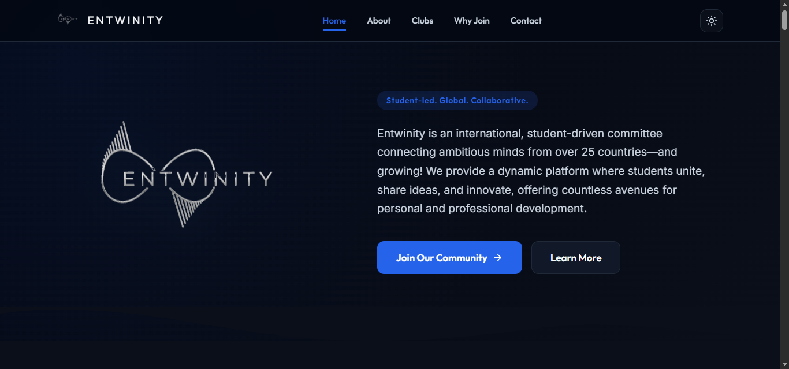

</td>

<td>

# Entwinity - Student Community Website

This website serves as the central hub for the community, where visitors can learn about Entwinity, explore our clubs, connect with the community, and get in touch with our team.

### Features

- Completely self-hosted!
- Using dynamic DNS from no-ip
- HTML, CSS, JS
- Python Flask - based backend Mail Service
- No Code Club edits - Dynamic Club Loading
- Dark and Light mode (atleast for a person like me)

</td>

</tr>

</table>

---
<!-- 
<table>

<tr>

<td width="40%">

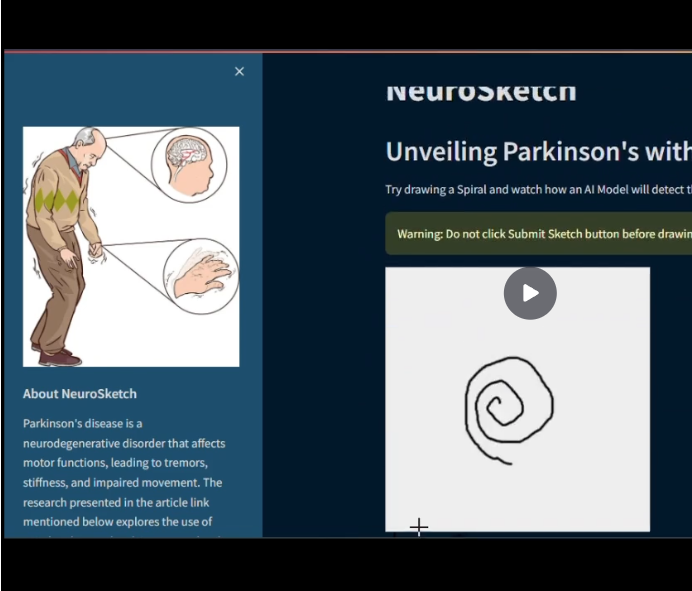

</td>

<td>

# NeuroSketch

AI-powered neurological screening platform designed for early detection using simple online tests.

### Modules

- Parkinson's Screening
- Spiral Analysis
- Voice Analysis
- Finger Tapping
- Hand Tracking
- Reaction Test
- Memory Test

**Goal**

Making neurological health screening more accessible.

</td>

</tr>

</table>

---

<table>

<tr>

<td width="40%">

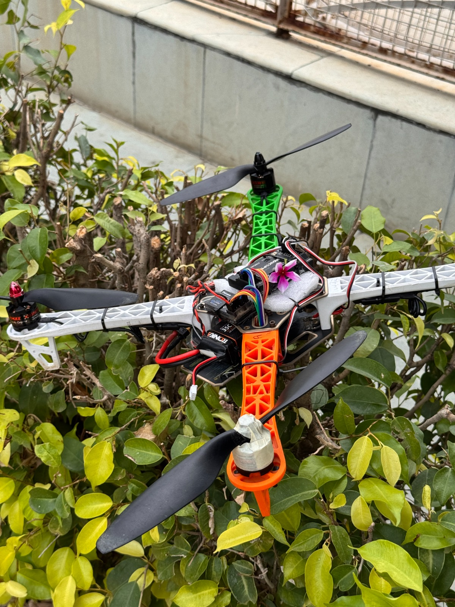

</td>

<td>

# Custom Quadcopter

Designed and assembled a custom-built quadcopter.

### Specifications

- EMAX 920KV Motors
- 30A ESC
- APM 2.8 Flight Controller
- 10-inch Propellers
- GoPro Payload
- FlySky i6

</td>

</tr>

</table>

---

<table>

<tr>

<td width="40%">

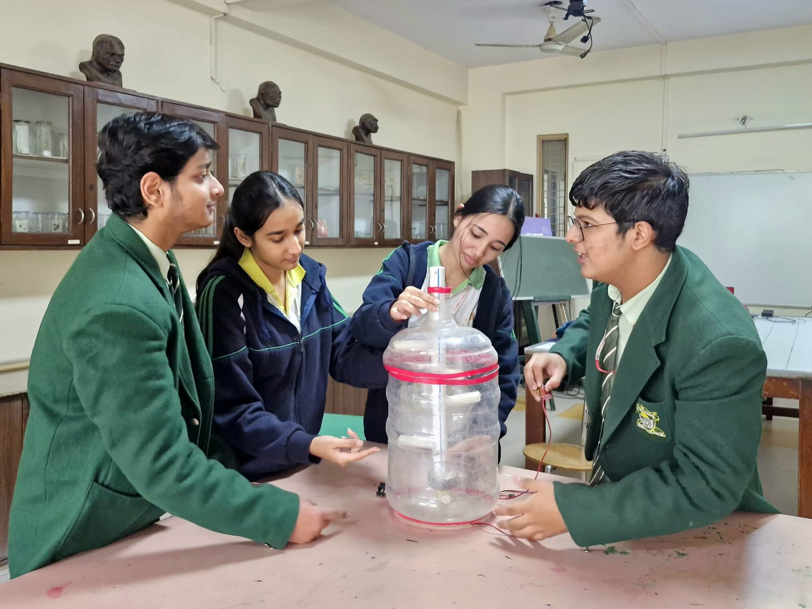

</td>

<td>

# ReSoil

Research & Development project focused on sustainable biofertilizer compost generation.

Status:

Ongoing Research

</td>

</tr>

</table>
-->


---

# 🏆 Experience & Leadership

### Co-Founder - Knight Labs **(May 2025)**

Solving modern problems with IoT and 

---

### Vice President — THE QU4D COACH **(Oct 2025 - Present)**

Vice President of The QU4D COACH, a community dedicated to helping people learn and build their own drones. Leading technical development, mentoring, and making drone technology accessible through hands-on learning.

**Location:** India

---

<!-- 
# 📸 Gallery

<table>

<tr>

<td></td>
<td></td>
<td></td>

</tr>

<tr>

<td></td>
<td></td>
<td></td>

</tr>

</table>
-->
---

# Currently Exploring

- Flight Controller Development
- PCB Design
- Embedded AI
- ESP32 Development
- Autonomous Robotics
- RTOS
- Computer Vision
- Sensor Fusion
- Drone Navigation

---

# Future Goals

- Build an open-source flight controller.
- Develop affordable engineering solutions for education.
- Contribute to robotics and embedded systems research.
- Pursue engineering focused on robotics, embedded systems, and aerospace technologies.
- Continue mentoring and growing engineering communities.

---

# 🤝 Let's Connect

I'm always open to collaborating on exciting engineering projects, robotics, embedded systems, PCB design, drones, and AI.

<p>

<a href="https://www.linkedin.com/in/prajeshnair">LinkedIn</a> •
<a href="https://github.com/Prajesh-Nair">GitHub</a> •
<a href="mailto:nairprajesh2007.github@gmail.com">Email</a>

</p>

---

<div align="center">

### *"Create • Build • Innovate"*

If you like my work, follow my journey!

</div>
